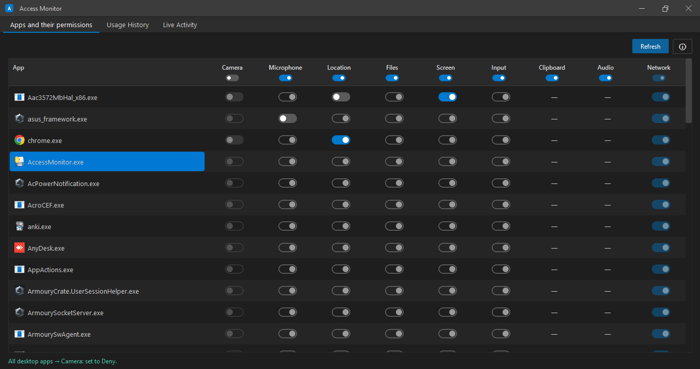
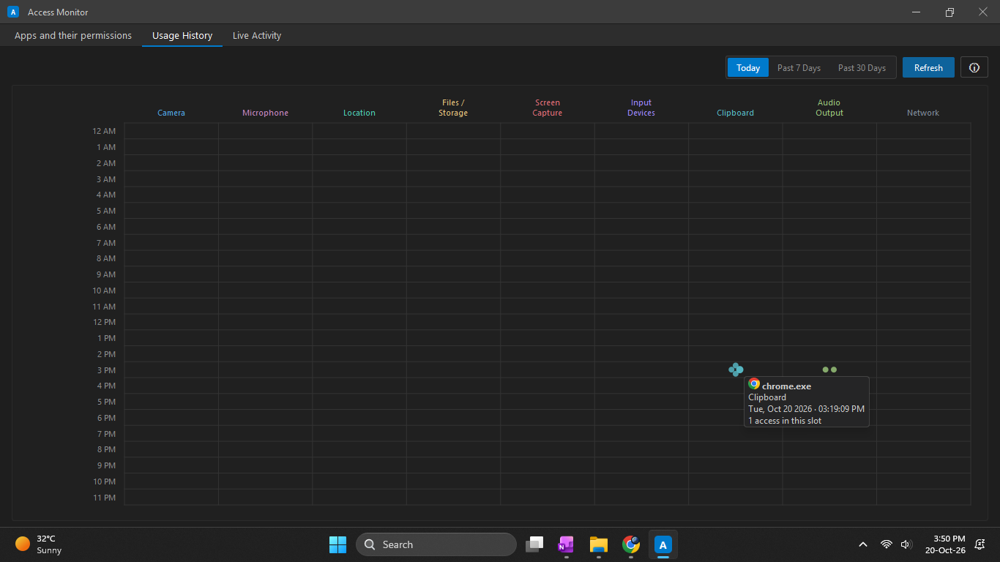
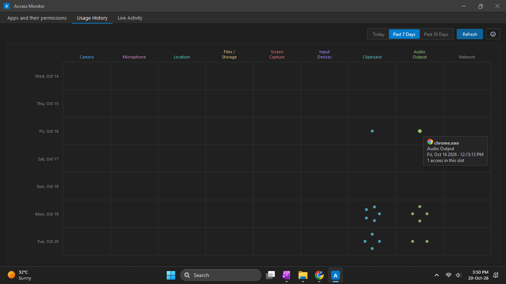
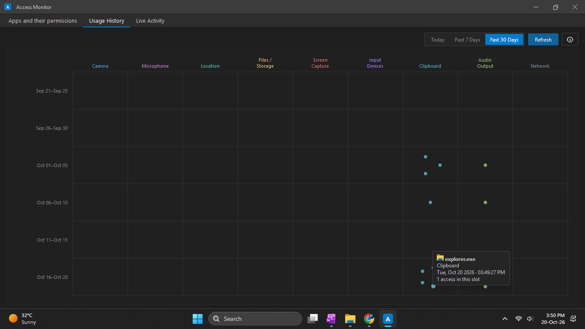
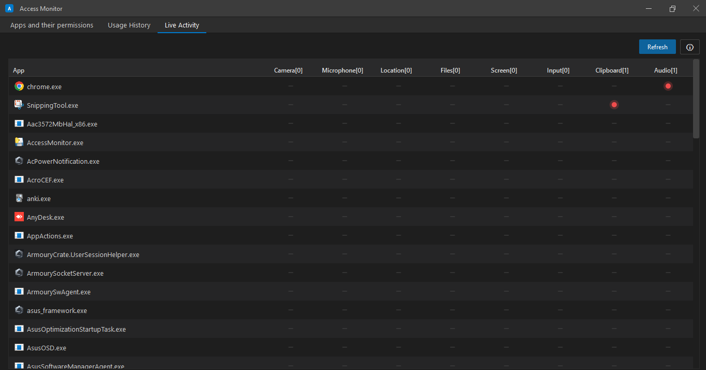

<a id="readme-top"></a>

# About The Project

Access Monitor is a small Windows app that shows which apps on your PC can use things like your Camera, Microphone, or Location — and lets you turn those permissions on or off. It also shows which apps are using those tools right now, live, and keeps a simple history of past use. The app has two parts: a Python window you see and click on, and a small C program behind it that talks directly to Windows to read and change the real permission settings.

<p align="right">(<a href="#readme-top">back to top</a>)</p>

# Built With

* 
* 
* 
* 

<p align="right">(<a href="#readme-top">back to top</a>)</p>

# Project Overview

### Key Features

- Shows every app on your PC and which permissions it has (Camera, Microphone, Location, Files, Screen, Input)
- One click turns a permission on or off for every app at once
- A separate Live Activity page shows, second by second, which app is using which tool right now
- A Usage History page shows the last 30 days as a simple dot chart — hover a dot to see which app, when, and how many times
- Works straight from Windows' own permission settings — nothing fake or simulated

### The Three Pages

- **Apps and their permissions** — a table of every app and its permission switches
- **Usage History** — a 30-day activity chart you can filter by Today / Past 7 Days / Past 30 Days
- **Live Activity** — a live, auto-refreshing view of what's using what, right now

### Project Files

- `access_monitor_gui.py` — the window you see and use (Python + PySide6)
- `access_monitor_core.c` — the part that reads and changes Windows' real permission settings (C)
- `access_monitor_core.dll` — the compiled version of the C file, built from source

### Good To Know

- Windows only — this app will not run on macOS or Linux
- Turning the Network permission on/off needs the app to be run as Administrator; everything else works without it
- History is saved only on your own PC (nothing is sent anywhere), and only the last 30 days are kept

<p align="right">(<a href="#readme-top">back to top</a>)</p>


# How To Run The .exe File

No Python, no setup — just download and double-click.

1. Go to the [Releases](../../releases) page
2. Download `AccessMonitor.exe`
3. Double-click `AccessMonitor.exe` to open the app

> Windows may show a blue "Windows protected your PC" warning — this happens because the app isn't code-signed, not because something is wrong. Click **"More info"**, then **"Run anyway"**.
>
> Want to turn the Network switch on or off too? Right-click `AccessMonitor.exe` and choose **"Run as administrator"** instead of double-clicking it.

<p align="right">(<a href="#readme-top">back to top</a>)</p>


# How To Run from source code

This project already comes with a built `access_monitor_core.dll` file, so you can run the app right away — no compiling, just these 3 steps.

**Step1. Install Python**
```bash
winget install -e --id Python.Python.3.12
```
(Or download it from [python.org](https://www.python.org/downloads/). While installing, tick **"Add python.exe to PATH"**.)

**Step2. Install PySide6**
```bash
pip install PySide6
```

**Step3. open cmd and run below commands**
```bash
cd project_folder_path
python access_monitor_gui.py
```

That's it — the app opens using the `.dll` file already sitting in the project folder.

> Want to use the Network switch too? Open Command Prompt **as Administrator** before step 3.

<p align="right">(<a href="#readme-top">back to top</a>)</p>

**Step4 (Optional).Creating The .dll File**

You only need this if you changed `access_monitor_core.c` yourself. The `.dll` file already in this project was made the same way — you don't have to redo it just to run the app.

1. Open "MSYS2 MinGW64" from the Windows Start menu
2. Go to the project folder:
```bash
cd project_folder_path
```
(MSYS2 uses forward slashes `/` in paths, not backslashes `\` — so change the path if needed, for example `C:/Users/You/AccessMonitor` instead of `C:\Users\You\AccessMonitor`.)

3. Run this command:
```bash
gcc -shared -s -O2 -Wall -D_UNICODE -DUNICODE access_monitor_core.c -o access_monitor_core.dll -lole32 -loleaut32 -lkernel32 -ladvapi32 -luser32 -lpsapi -lnetapi32 -static-libgcc
```
4. Open your project folder — you will see a new `access_monitor_core.dll` file there

<p align="right">(<a href="#readme-top">back to top</a>)</p>


# Sample Visualizations





<p align="right">(<a href="#readme-top">back to top</a>)</p>
